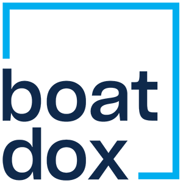

# BoatDox Help

Find help for BoatDox deals, documents, signatures, contacts, and team workflows.

!!! info "Guides in preparation"

    Our documentation is being prepared and reviewed. The topics below are planned guides; they do not confirm that a workflow is available for every account.

## Browse topics

- **[Getting Started](getting-started/index.md)** — Account setup, signing in, and the dashboard.
- **[Deal Management](deals/index.md)** — Deals, participants, and deal information.
- **[Documents](documents/index.md)** — Document templates, preparation, and signatures.
- **[CRM](crm/index.md)** — Contacts and contact information.
- **[Team Management](teams/index.md)** — Team members, access, and permissions.
- **[Mobile Application](mobile/index.md)** — Getting started with the mobile application.
- **[Troubleshooting](troubleshooting/index.md)** — Answers to common BoatDox questions.

## Need help now?

[Visit boatdox.org](https://boatdox.org/) or see [contact support](../support/contact.md).
