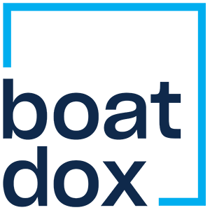

# How can we help?

Find your way around IYBA, YachtBroker, and BoatDox. Choose a product below,
or use **Search** in the header to search across the help center.

-   { .product-logo }

    **IYBA**

    Membership, your association profile, and the IYBA website.

    [Explore IYBA documentation →](iyba/index.md)

-   { .product-logo }

    **YachtBroker**

    Vessel listings, brokerage profiles, and customer inquiries.

    [Explore YachtBroker documentation →](yachtbroker/index.md)

-   { .product-logo }

    **BoatDox**

    Deals, documents, contacts, and your team.

    [Explore BoatDox documentation →](boatdox/index.md)

## Need a hand?

- [Contact support](support/contact.md)
- [Frequently asked questions](support/frequently-asked-questions.md)
- [Product websites and resources](support/product-resources.md)

!!! info "Documentation is growing"

    Our product guides are being prepared. Pages marked **Guide in preparation**
    do not yet contain verified instructions. Visit the product website or
    contact support if you need help today.
