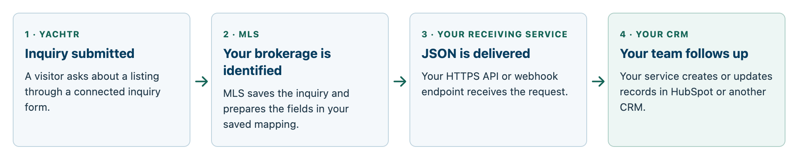
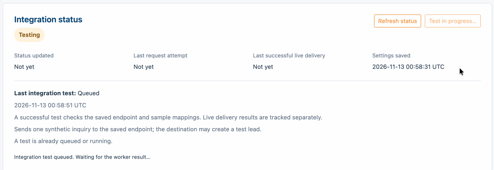

# Outbound Leads — YachtBroker

Send Yachtr inquiries for your brokerage’s listings to the system your team uses
to follow up. MLS delivers the fields you choose to a receiving service, which
creates or updates records in HubSpot or another CRM.

This guide is for **company administrators and their CRM or integration partners**.

## How It Works



Your connection receives inquiries routed to your brokerage, not every inquiry
across Yachtr. Delivery runs in the background, and there is **one saved
destination per brokerage**.

Your CRM provider, development team, or integration partner supplies the
receiving endpoint: the web address MLS sends inquiries to. It can be a compatible
incoming webhook, a proprietary API, or a service that translates the information
into your CRM’s format.

??? info "Using HubSpot or another CRM"

    This integration sends a flat JSON object using HTTPS POST. Your receiving
    service handles CRM authorization, contact matching, field conversion, and
    any deal or activity creation.

    Third-party CRM APIs may expect nested fields, so your receiving service may
    need to transform the payload received from the YachtBroker MLS API before
    forwarding it to the CRM. A CRM endpoint that already accepts your configured
    format may receive requests directly.

    MLS supports a fixed Bearer token or a token in a named request header. Your
    receiving service handles any downstream OAuth authorization or token refresh.

## Before You Begin

You need company administrator access to **Brokerage → Outbound Leads**.
Ask your CRM or integration partner for these details:

| Item | What you need |
| --- | --- |
| Receiving URL | A public HTTPS URL that accepts POST requests containing JSON, without a redirect. Use a test endpoint if available. |
| Authentication | A Bearer token, or an API key/token and its exact header name, such as `x-auth-token`. These credentials are for the receiving endpoint. |
| Field requirements | Exact destination field names, required fields, accepted values, and any fields that must contain JSON `null`. Agree how the listing and inquiry will be stored alongside the contact. |
| Success response | The HTTP status codes that mean acceptance, such as 200, 201, or 202. The endpoint must respond within your configured timeout, up to 30 seconds. |
| Network access | If the endpoint restricts traffic, share **Connection details for allowlisting** from the settings page, including source IPs, DNS names, provider, region, and whether addresses are static or rotating. |
| CRM behavior | Agree who receives inquiries, how existing contacts and repeat requests are handled, which records or tasks are created, and who investigates downstream failures. |

If the allowlisting details say **Not configured**, request them from the MLS
administrator. DNS names work only when your receiving service supports DNS
allowlisting. The MLS website address is not necessarily the address used to send
requests.

### Available fields

Only fields in your saved mapping are sent. Your receiving team chooses the
destination field names. An available field may still be empty on an individual
inquiry or listing.

| Information | What to expect |
| --- | --- |
| Contact details | Full name, email, and phone. An accepted inquiry includes email or phone; both are not guaranteed. Full name is a single value without automatic first/last-name splitting. |
| Inquiry message | The visitor’s message. Map it to your receiver’s field, such as `AdditionalComments`. |
| Listing ID and URL | MLS vessel ID and the listing page URL supplied with the inquiry. |
| Vessel name, make, model, year | Values from the associated MLS listing. Choose **Manufacturer** for the make and **Model** separately. |
| Stock number and HIN | The listing’s stock number and hull identification number, when present. Stock number is separate from the MLS vessel ID. |
| Lead source | Set a constant such as `yachtr.com`. Automatic campaign or UTM attribution is not included. |
| Submission reference | Form submission ID and form ID, useful for tracing inquiries and handling repeat requests. |

Need a field that isn’t listed? Contact support to request additional mapping
support for listing data. Additional fields may be supported if the data is
available in MLS.

!!! note "Broker-only inquiries"

    A broker-only inquiry identifies the broker being contacted and can route to
    that broker’s brokerage. It does not provide a listing or identify whether the
    sender is a professional broker or a retail buyer.

## Steps

### 1. Configure the connection

Open **Brokerage → Outbound Leads**. Enter the receiving URL, authentication,
success response codes, and timeout agreed with your partner. Keep live delivery
disabled during initial setup.

### 2. Map your fields

For each outgoing field, enter the destination field name and choose its source:
**Lead field**, **Vessel field**, **Constant value**, or **Null**.

| Example destination field | Source | Value |
| --- | --- | --- |
| `EmailAddress` | Lead field | Email |
| `AdditionalComments` | Lead field | Message |
| `Make` | Vessel field | Manufacturer |
| `StockNumber` | Vessel field | Stock number |
| `LeadSource` | Constant value | `yachtr.com` |
| `LeadMedium` | Null | JSON `null` |

A fallback supplies fixed text when a source is empty. If you select
**Require a value before sending** and neither a value nor a fallback is
available, delivery stops before sending. An optional field without a value is
omitted.

Choose **Null** to include a field with JSON `null`. Typing `null` into a constant
sends the text `"null"` instead.

??? example "Example outgoing JSON"

    This example uses synthetic data and illustrative destination field names;
    it is not a required CRM schema. Listing details reflect MLS values when
    delivery is prepared.

    ```json
    {
      "FullName": "Alex Morgan",
      "EmailAddress": "alex@example.com",
      "PhoneNumber": "+1 202-555-0142",
      "AdditionalComments": "I would like more information about this vessel.",
      "ListingId": 2859072,
      "VesselName": "Sea Breeze",
      "Make": "Example Boats",
      "Model": "Cruiser 40",
      "Year": 2026,
      "StockNumber": "STK-1042",
      "ReferringURL": "https://example.com/listings/2859072",
      "LeadSource": "yachtr.com",
      "LeadMedium": null,
      "SubmissionId": 14419,
      "FormId": 1
    }
    ```

Save your settings before testing. Saving alone does not send a test or replay
existing inquiries.

### 3. Send and verify a test

Select **Test integration**. It works while live delivery is disabled and sends
a real request containing synthetic contact and listing values. Configured
constants are sent exactly as saved.



!!! warning "Tests may create real CRM records"

    Coordinate with your receiving team before testing, and direct any test
    notifications to them. The sample uses synthetic inventory data, including
    stock number `STK-1042`. An endpoint that requires an existing inventory record
    may reject it.

In **Recent deliveries**, use **View JSON** to compare the saved attempt with
your partner’s field list. Ask your partner to confirm the CRM record, field
values, contact matching, and assignment.

### 4. Enable live delivery

Enable and save the connection. Submit a controlled new inquiry on an eligible
listing and verify it in both MLS and your CRM. This checks brokerage routing and
actual listing data as well as delivery.

## Expected Result

New eligible inquiries appear in your receiving service, and your partner
confirms the expected CRM records and assignments. Check **Last successful live
delivery** separately from the test result to confirm that real inquiries are
flowing.

!!! info "Delivered confirms endpoint acceptance"

    **Delivered** means the receiving endpoint returned one of your configured
    success codes. It does not confirm that a contact, inquiry, deal, or activity
    was created in the CRM. Your receiving team verifies that step.

## Troubleshooting

| What you see | What to do |
| --- | --- |
| **Delivered**, but missing from the CRM | Ask the receiving team to investigate processing after receipt. |
| **Failed** | Review the reason, HTTP status, and **View JSON**. Correct the endpoint, credentials, or mapping. Then open **Failed leads** to retry eligible failed live deliveries. Saving a correction does not retry them automatically. |
| **Receipt unconfirmed** | MLS cannot confirm whether the destination accepted the request. Check with the receiving team before sending another copy. These attempts are not offered for routine retry. |
| **Queued** or **confirmation pending** | Use **Refresh status**. Contact MLS support if the request remains stalled. |
| **Test passed**, but no live inquiries | Check **Last successful live delivery**, confirm the connection is enabled, and verify a controlled new inquiry from an eligible listing. |
| Inquiry never appears in MLS | Contact MLS support to check the source form and routing. |

Failed attempts are retained for review. A retry uses the latest saved settings
and current listing values, and keeps the earlier attempt in history.
**View JSON** shows the payload saved for the selected attempt; opening it never
resends the inquiry.

Repeated submissions of the same Yachtr form entry do not create another MLS
lead or replace the original inquiry. Your receiving service should also handle
repeat requests safely.

When requesting help, provide your brokerage name, inquiry or attempt ID, time,
HTTP status, and displayed reason. Share relevant field examples through your
usual secure support channel. Keep API keys out of screenshots and messages.

## Related Articles

- [Leads & Inquiries](index.md)
- [YachtBroker Help](../index.md)
- [Contact Support](../../support/contact.md)
